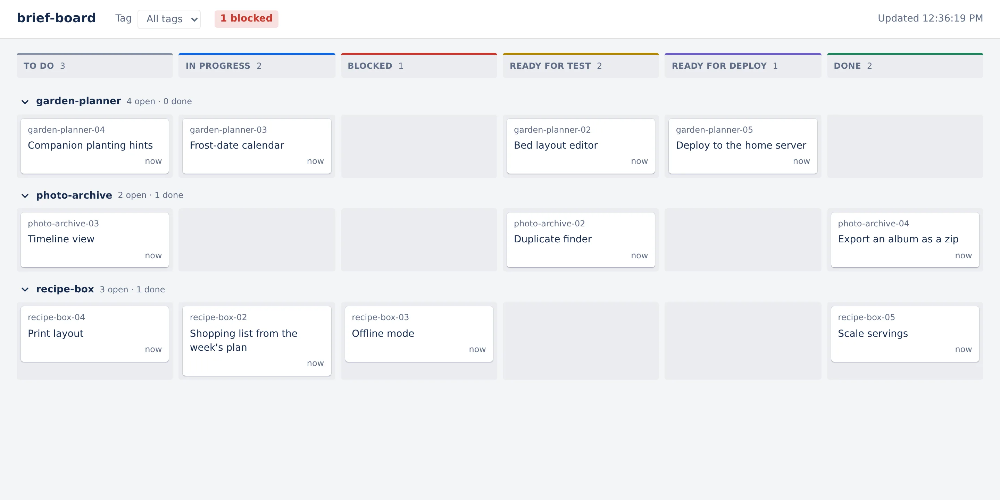
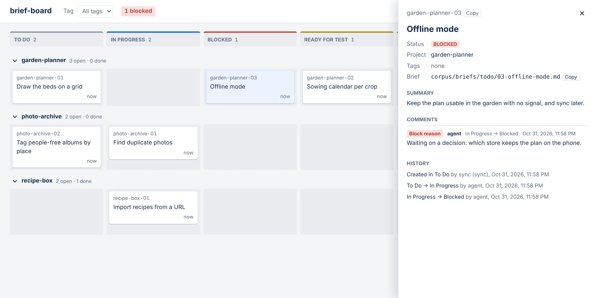

# brief-board

A Jira-style board showing where every corpus brief stands across all the projects in `~/projects`, so the owner can see at a glance what each agent is doing and what is waiting for them.

<p align="center">
  
</p>

**Status:** Personal tool, built 2026-10-09 and in use. It runs on the owner's machine only; there is no hosted copy.

## What it does

- Shows one lane per project and six columns: To Do, In Progress, Blocked, Ready for test, Ready for deploy, Done.
- Lets agents create and move tickets with the `brief-board` command, with a required reason when they block a ticket or hand it to the owner.
- Keeps comments and history on each ticket, so a later session can see what the last one did.
- Rebuilds itself from the projects' corpora with `brief-board sync`, so losing the board loses nothing.

The corpus in each project stays the source of truth: a ticket holds a summary and a path to its brief, never a copy of the spec. The board is read-only in the browser, and the owner tells an agent what to move. It is not a general task tracker.

## Screenshots

| A blocked ticket, with its reason and history |
|---|
|  |

## How it works

Four npm workspaces. `shared` defines the statuses, the allowed moves and the API contract. `server` is a Fastify API on 127.0.0.1 backed by SQLite; it enforces the moves and serves the built board. `web` is the read-only React board, which polls the API. `cli` is the `brief-board` command that agents use. More in [docs/architecture.md](docs/architecture.md).

```bash
brief-board start 3 -m "Starting with the parser."     # To Do → In Progress
brief-board move 3 blocked -m "Needs a decision: X or Y?"
brief-board list
```

## Run it locally

Requires Node 24 or later.

```bash
npm install
npm run build
npm start          # API and board on http://127.0.0.1:8806
```

Then put the CLI on your PATH, fill the board, and point agents at it: [docs/getting-started.md](docs/getting-started.md).

## Docs

- [docs/](docs/README.md): setup, architecture and the images used here
- [Project wiki](corpus/index.md): decisions, glossary, status and the briefs that built it
- `brief-board guide` prints the rules agents follow

## License

[MIT](LICENSE)
