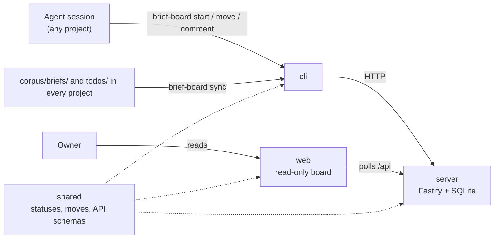

# Architecture

brief-board is four npm workspaces. Agents write through the CLI, the server enforces the rules, and the owner reads the board in a browser.

- **shared** holds the status names, the move table and the zod schemas. The other three import it, so a rule exists in one place.
- **server** (`server/src/app.ts`, `store.ts`, `sync.ts`) listens on 127.0.0.1:8806, stores tickets in SQLite, rejects moves the table does not allow, and requires a message where the table says one is needed. It also serves the built board.
- **web** is a Vite + React board. It never writes. It polls the API; Backlog is the first column, the Done column shows the last 14 days, and lanes with nothing open start collapsed.
- **cli** (`cli/src/`) is the only client agents use. It finds the board from `BRIEF_BOARD_URL`, the repo's `.env`, `~/.config/brief-board/env` or the default, and takes the project name from the nearest corpus's `corpus/board-name`, else the git root directory.

## A ticket's life

1. A brief is filed in some project's `corpus/briefs/todo/`.
2. `brief-board sync` (or `brief-board create`) makes a To Do ticket with the brief's title and first paragraph.
3. The agent runs `brief-board start <n>` when work begins. That opens a run on the ticket, which every write the agent makes keeps fresh; after 4 hours with none it reads as stale. A session that stops an agent ends its run with `brief-board release`, and `brief-board runs` lists the open ones. What the agent starts that outlives a command (a port, a pid, a container, a path) it declares with `brief-board hold` and takes off with `drop`; the end move and `release` print what is still held, and the ended run keeps it as its leftovers.
4. It ends with `move <n> done`, or `ready_for_test` / `ready_for_deploy` with a note when the owner has a step left, or `blocked` with a reason. Any move out of In Progress ends the run. Questions for the owner ride on a move, comment or start as `--question`; the card counts the open ones in a badge until `brief-board answer` records the owner's answer, and `brief-board questions` lists them across projects.
5. Everything waiting on the owner (open questions, Blocked tickets, stale runs, Ready for test, Ready for deploy) is gathered by `brief-board needs` and the strip above the lanes, which narrows the board to one kind at a click.
6. The brief file moving to `done/` stays the record; sync makes the board agree with it, except that it leaves an In Progress ticket whose run is still fresh for that run's end move.

Before a brief there may be a todo. Each open todo in `corpus/todos/` has a ticket in Backlog, keyed `<project>:<slug>`, which only sync makes, keeps and removes: no agent moves or comments on it. Promoting the todo deletes its file, so the next sync takes that ticket off and files the brief's in To Do.

## Going deeper

- [corpus/wiki/architecture.md](../corpus/wiki/architecture.md): the as-built description
- [corpus/wiki/decisions.md](../corpus/wiki/decisions.md): why the board is read-only, why the corpus wins, the move table
- [corpus/wiki/glossary.md](../corpus/wiki/glossary.md): brief vs ticket, and the other terms
