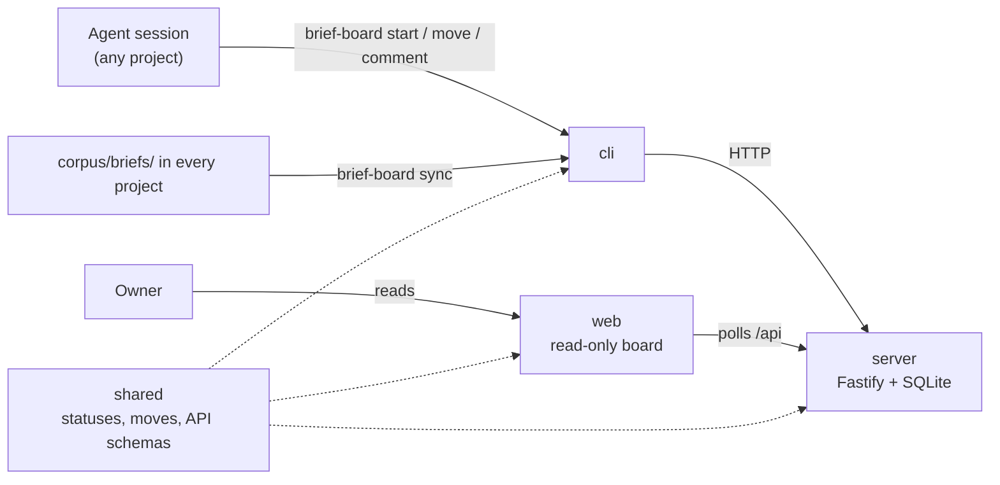

# Architecture

brief-board is four npm workspaces. Agents write through the CLI, the server enforces the rules, and the owner reads the board in a browser.

- **shared** holds the status names, the move table and the zod schemas. The other three import it, so a rule exists in one place.
- **server** (`server/src/app.ts`, `store.ts`, `sync.ts`) listens on 127.0.0.1:8806, stores tickets in SQLite, rejects moves the table does not allow, and requires a message where the table says one is needed. It also serves the built board.
- **web** is a Vite + React board. It never writes. It polls the API; the Done column shows the last 14 days, and lanes with nothing open start collapsed.
- **cli** (`cli/src/`) is the only client agents use. It finds the board from `BRIEF_BOARD_URL`, the repo's `.env`, `~/.config/brief-board/env` or the default, and takes the project name from the git root directory.

## A ticket's life

1. A brief is filed in some project's `corpus/briefs/todo/`.
2. `brief-board sync` (or `brief-board create`) makes a To Do ticket with the brief's title and first paragraph.
3. The agent runs `brief-board start <n>` when work begins.
4. It ends with `move <n> done`, or `ready_for_test` / `ready_for_deploy` with a note when the owner has a step left, or `blocked` with a reason.
5. The brief file moving to `done/` stays the record; sync makes the board agree with it.

## Going deeper

- [corpus/wiki/architecture.md](../corpus/wiki/architecture.md): the as-built description
- [corpus/wiki/decisions.md](../corpus/wiki/decisions.md): why the board is read-only, why the corpus wins, the move table
- [corpus/wiki/glossary.md](../corpus/wiki/glossary.md): brief vs ticket, and the other terms
